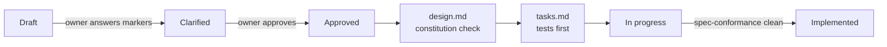

# SpecForge

A ruleset for building software with AI coding agents, and the means to add it to a project — one
with no code yet, or one long in production. It brings:

- **Coding rules:** stack-neutral core conventions, realised per stack by profiles for **Laravel**,
  **ASP.NET Core**, **Next.js**, **React** and **Vue** — in any combination per project.
- **Spec rules:** spec-driven development, where behaviour is specified, approved and traced to
  tests.
- **Audit rules:** eighteen read-only audits under one protocol.
- **Document rules:** where every decision, finding and plan is written.

The rules reach **every coding agent** — Claude Code, Codex, Cursor, Copilot, Windsurf,
Antigravity, Gemini CLI and Kiro — from one source, and are enforced by a check that runs in CI
whoever wrote the change.

It is not a project scaffolder or a repository template. It creates no project, no application
code and no project infrastructure, and it needs no version control.

> **Status.** v0.1.0 is the first release. The installer is tested under Bash 5 with GNU tools and
> under Bash 3.2 with BusyBox.

## Install

### 1. Run the installer

From the project directory, new or existing:

```bash
curl -fsSL https://shakilnwz.github.io/specforge/install.sh | bash
```

From a checkout of this repository, with no download:

```bash
./install.sh --dir ~/code/my-app --from .
```

It first detects what the project already is: its apps and their stacks, the coding agents
configured, and the code host. Then it asks five questions, as numbered menus or yes/no, each
defaulting to what it found:

1. a new project, or an existing one;
2. each app's path and its profiles, in any combination. A frontend inside a server app
   (`resources/js`, `ClientApp`) is a path of its own;
3. the coding agents in use;
4. whether a Gherkin runner executes the acceptance scenarios;
5. the code host.

It installs the rules those answers select, fills `.ai/agents` and the **Stacks** table, and
generates every chosen agent's rule files. It records what it did in `.ai/specforge.lock`. A file
the project already has is never overwritten: the kit's version goes beside it as
`<file>.specforge-incoming`, for the agent to reconcile during adoption.

Without questions, in CI or for a second project with the same architecture:

```bash
cat > rules.answers <<'EOF'
state=existing
app=. laravel
app=resources/js vue
agents=claude cursor
gherkin=no
host=github
EOF
./install.sh --dir ~/code/my-app --from . --answers rules.answers
```

A project's `.ai/specforge.lock` is itself a valid answers file. `--dry-run` shows what would change
and changes nothing. Options follow `bash -s --` when the script is piped. Every script, option and
answer key is listed under [Commands and options](#commands-and-options), and by each script's
`--help`. Reading a script before piping it to a shell is the better habit:

```bash
curl -fsSLo install.sh https://shakilnwz.github.io/specforge/install.sh
less install.sh && bash install.sh --dry-run
```

### 2. Hand over to an agent

Open the project in any of your agents and say one of these:

| The project… | Say | The agent follows |
| --- | --- | --- |
| has no code yet | *Run the bootstrap prompt.* | [`bootstrap.md`](template/.ai/prompts/bootstrap.md) |
| already has code | *Run the adopt prompt.* | [`adopt.md`](template/.ai/prompts/adopt.md) |

**Bootstrap** asks you, in one round, for:
- the product, its capabilities and its vocabulary;
- the stack of each app;
- the shape of the system: apps, surfaces, modules and modularity level;
- your constraints.

It then writes ADR-0001 and ADR-0002 as Proposed, the context page and the glossary seed, and fills
`AGENTS.md`. It *reports* — never creates — the project infrastructure G0 expects.

**Adopt** reads the code first and asks only what the code cannot settle. It then:
- records the existing stacks and shape as retroactive ADRs;
- lists every existing capability on a **legacy register**;
- runs baseline audits;
- measures existing violations for **baselines that only shrink**;
- assesses every gate to name the phase the evidence supports.

Both end with a phase-gate report.

### 3. Take the owner's decisions, and switch on enforcement

- Accept or amend the ADRs, and set `AGENTS.md`'s **Phase** line from the gate report.
- Add `.ai/bin/check` to CI beside each app's lint, type check, tests and arch tests.
- For a Laravel app with Laravel Boost, run `php artisan boost:install`; the installer reminds you
  when it finds Boost. Boost keeps `.ai/rules/index.md` in the format `sync-rules` writes, and owns
  `.ai/rules/boost/`.

### Keeping the rules current

From the project directory, with the `update.sh` of the version you want:

```bash
curl -fsSL https://shakilnwz.github.io/specforge/update.sh | bash
#   … | bash -s -- --reconfigure     answer the questions again: add a stack, drop an agent

# take back what was installed and is still unmodified
curl -fsSL https://shakilnwz.github.io/specforge/uninstall.sh | bash

# or from a checkout of this repository
./update.sh --dir ~/code/my-app --from .
./uninstall.sh --dir ~/code/my-app
```

`update.sh` replaces only what is still as the kit installed it. A file you changed stays yours, and
the kit's newer version is offered beside it only when the kit's version has changed too. A file you
deleted is not restored. Agents can also be changed by editing `.ai/agents` and running
`.ai/bin/sync-rules`.

## How the rules reach every agent

Agents disagree on where path-scoped rules live and how a rule declares its files, and some silently
drop a rule they cannot parse. So the rules are written once and delivered three ways:

1. **`AGENTS.md`, read by every agent.** It carries the authority order and the read-before-write
   protocol, including *"open `.ai/rules/index.md` and read every rule whose globs cover the paths
   you touch"*. An agent with no rules mechanism of its own still follows the rules this way.
2. **Native copies, generated.** `.ai/rules/*.md` is the one source. For each agent in `.ai/agents`,
   `.ai/bin/sync-rules` writes that agent's own format, so the agent loads the right rule
   automatically when it touches a matching file:

   | Agent | Generated | Scoped by |
   | --- | --- | --- |
   | Claude Code | `.claude/rules/ai-*.md` (`CLAUDE.md` imports `AGENTS.md`) | `paths:` |
   | Cursor | `.cursor/rules/ai-*.mdc` | `globs:` / `alwaysApply:` |
   | GitHub Copilot | `.github/instructions/ai-*.instructions.md` | `applyTo:` |
   | Windsurf / Devin | `.windsurf/rules/ai-*.md` | `trigger: glob` / `globs:` |
   | Google Antigravity | `.agents/rules/ai-*.md` | `trigger: glob` / `globs:` |
   | Kiro | `.kiro/steering/ai-*.md` | `inclusion: fileMatch` / `fileMatchPattern:` |
   | Gemini CLI | `.gemini/settings.json`, if absent, pointing it at `AGENTS.md` | — |
   | Codex | nothing: it reads `AGENTS.md` | — |

   Each generated file carries a marker line. Files without that marker — your team's own rules
   beside them — are never overwritten or removed. Removing an agent from `.ai/agents` removes its
   generated files. `sync-rules` also writes `.ai/rules/index.md` byte for byte as Laravel Boost
   does, and reports any rule whose frontmatter Boost would rewrite.
3. **Enforcement that ignores who wrote the change.** Instructions guide an agent; they do not stop
   one. `.ai/bin/check` runs in CI and fails when:
   - a generated file has drifted from `.ai/rules/`;
   - a placeholder is left after Phase 0;
   - a requirement of an Implemented spec is cited by no test;
   - `AGENTS.md` outgrows Codex's 32 KiB, or an Antigravity rule its 24,000 bytes.

   The stack's own gates — lint, type check, tests, arch tests — run beside it.

Both scripts are Bash 3.2 with POSIX tools: no git, no network, no runtime of any stack.

## Using it day to day

Everything is driven by asking the agent in plain language. The prompts, conventions and rule files
tell it what to read, what to write and when to stop.

| You say | The agent | You get |
| --- | --- | --- |
| *Draft a spec for refunds* | Writes EARS requirements with permanent IDs; scenarios, refusals included; quantified non-functional requirements; what is out of scope. Marks every open question `[NEEDS CLARIFICATION: …]` | `docs/specs/NNNN-refunds/spec.md`, status Draft |
| *(you answer the markers)* | Records each answer in the clarification log | Status Clarified |
| *(you approve)* | — this step is yours alone | Status Approved |
| *Design spec 0007* | Places the work in modules and surfaces, checks the design against every convention it touches, proposes ADRs for new decisions | `design.md`, and ADRs as Proposed |
| *Plan the tasks for 0007* | Orders small, verifiable tasks — acceptance tests before code — each citing its requirement IDs | `tasks.md` |
| *Implement 0007 T3* | Reads the rules and profile for the paths, writes the failing tagged test, then the code; ticks the task | Code, tests tagged `0007.R2`, a ticked box |
| *Verify spec 0007* | Runs the spec-conformance audit scoped to the spec, in both directions: missing and divergent behaviour, and overreach | A clean run moves the spec to Implemented |
| *Change how invoices round totals* (a legacy capability) | Pins today's behaviour with characterization tests, writes the spec that states it, then amends that spec for the change | A spec, and the legacy-register row closed when it is Implemented |
| *Fix: refunds over the balance are accepted* | Finds the requirement the bug contradicts — or reports a gap to specify first — and fixes it with a regression test tagged to it | A change for the `bugfix` PR template |
| *Plan a refactor of the billing module* | Scopes work that changes no behaviour | `docs/plans/<topic>.md` |
| *Run the naming audit* | Follows its prompt under the audit protocol, read-only | A report in `docs/reports/`, or rows in a living audit |
| *Run the phase gate for G2* | Verifies every criterion of the gate, and re-checks earlier ones for regression | A gate report and updated rows in `docs/audit/readiness.md` |
| *Record a rule: …* | Appends it to the matching `.ai/rules/` file, then runs `.ai/bin/sync-rules` | A rule every agent and the team will load |

**Reserved for the owner, never for an agent:**
- accepting ADRs, retroactive ones included;
- approving specs and their amendments;
- answering clarification markers;
- waiving a gate criterion;
- setting the **Phase** line;
- approving a baseline, a new dependency, module or top-level directory.

## Choosing your configuration

Each choice decides which rule files a project keeps and which ADR records it. The installer asks
the questions that change files (project state, profiles per path, agents, acceptance scenarios,
code host) and records the answers in `.ai/specforge.lock`. Bootstrap or adopt settles the rest.

| Decision | Choices | Keeps | Removes | Recorded in |
| --- | --- | --- | --- | --- |
| Project state | No code yet · existing code | No code: `bootstrap.md` path. Existing: `adopt.md` path, `docs/audit/legacy-capabilities.md`, baselines | — | ADR-0001/0002 (retroactive when existing) |
| Agents | Any of the eight above | Their lines in `.ai/agents`, and the files `sync-rules` generates | Generated files of agents not listed | `.ai/agents` |
| Shape | Single app · monorepo | Single: the rules at the project root. Monorepo: the rules at the root, one **Stacks** row per app path scoping its profiles, each app's own documents in `apps/<app>/docs/` | — | ADR-0002 |
| Profiles, per path | Any combination of Laravel · .NET · Next.js · React · Vue — e.g. Laravel with Vue or React in `resources/js`, or a Laravel API beside a Next.js app. Next.js brings React with it | `docs/conventions/stack-<name>.md` and `.ai/rules/<name>.md` for each profile in use | Profiles and rule files no path uses; then `sync-rules` | ADR-0001, `AGENTS.md` → **Stacks**, one row per path |
| Next.js mode | Full-stack · frontend over another app's API | Both live in `stack-nextjs.md` | — | ADR-0001 |
| Modularity | Not modular · Level 1 code · Level 2 data · Level 3 service | Everything; the modularity audit runs from G1 | Nothing. Not modular: the owner waives G1.2 and G3.6, citing ADR-0002 | ADR-0002 |
| Acceptance scenarios | In `spec.md` · a Gherkin runner (Behat, Reqnroll, playwright-bdd) | Runner: `docs/templates/feature.feature`, and `features/` as specs are written | No runner: `docs/templates/feature.feature` | ADR-0001 |
| Laravel Boost | Yes · no (Laravel apps only) | Yes: `php artisan boost:install` after installing the rules; the installer reminds you when it finds Boost | — | ADR-0001 |
| Code host | GitHub · other | GitHub: `.github/PULL_REQUEST_TEMPLATE/` | Other: those templates, their checklists ported to the host's | — |
| Database, cache, queue, hosting | Per app | No file changes; each profile covers its data-access options | — | ADR-0001 |

Always kept:
- the nine core conventions;
- every template the choices above do not remove;
- all eighteen audit prompts (a *Stack notes* row for an absent stack is inert);
- the core rule files and `.ai/bin/`;
- `docs/audit/readiness.md`, `AGENTS.md` and `CLAUDE.md`.

## How it works

### Core conventions and stack profiles

The core conventions use one vocabulary — entry point, Command, Action, Query, Model, Response,
surface, module — and state each rule once. A profile maps that vocabulary onto a stack:
- Laravel: a `FormRequest` and a readonly Command DTO;
- .NET: a `sealed record` handled by an `internal` handler;
- Next.js: a Zod schema behind a surface-wrapped server action.

The frontend profiles — Vue, and React, which the Next.js profile builds on — realise `frontend.md`
the same way.

A profile adds its stack's own pitfalls, and may sharpen a core rule or follow a language idiom
where it says so. It never relaxes a core rule. Stack rule files match by file type (`**/*.php`,
`**/*.cs`, `**/*.tsx`, `**/*.vue`), and `AGENTS.md`'s **Stacks** table decides which stack binds
which path, the most specific winning. So a Laravel app with React in `resources/js`, or a React
admin beside a Next.js shop in one repository, each get exactly their own profiles.

### Four rule sets

| Rule set | Lives in | Read by |
| --- | --- | --- |
| **Spec rules** — what is built, and how it is proved | [`specs.md`](template/docs/conventions/specs.md); the `spec`, `design`, `tasks` and `feature` templates | The owner and agents before any behaviour change |
| **Code rules** — how code is shaped and written | [`architecture`](template/docs/conventions/architecture.md), [`coding`](template/docs/conventions/coding.md), [`frontend`](template/docs/conventions/frontend.md), [`security`](template/docs/conventions/security.md), [`testing`](template/docs/conventions/testing.md), the `stack-*` profiles, routed to by `.ai/rules/` | Agents before any edit; reviewers on every PR |
| **Audit rules** — how code is examined | [`auditing.md`](template/docs/conventions/auditing.md) — protocol, ownership, severity, evidence, verification — and [`.ai/prompts/audits/`](template/.ai/prompts/audits/) | Whoever runs an audit, person or agent |
| **Document rules** — where findings and decisions go | [`documentation.md`](template/docs/conventions/documentation.md), [`docs/templates/`](template/docs/templates/) | Everyone writing a document |

When sources disagree, `AGENTS.md` ranks them, highest first:
1. the user's instruction;
2. the conventions;
3. the path-scoped rules;
4. accepted ADRs and Approved specs;
5. generated framework guidelines;
6. existing code.

### Spec-driven development



- **Traceability:** each requirement is followed through task, tagged test and code in every stack,
  so "is R2 proved?" is one grep, and `.ai/bin/check` asks it on every change. The tags:
  - Pest: `->group('0007.R2')`
  - xUnit: `[Trait("Requirement", "0007.R2")]`
  - Vitest: a `[0007.R2]` title prefix
  - Playwright and Gherkin: a `@0007.R2` tag
- **Overreach:** behaviour no requirement asks for is a defect. The spec-conformance audit's reverse
  sweep finds it.
- **Existing projects:** behaviour that predates the rules sits on the legacy register instead, and
  gets its spec the first time it changes.

### Lifecycle and gates

Five phases, each closed by a gate of checkable criteria — 40 in all. They are tracked in
[`docs/audit/readiness.md`](template/docs/audit/readiness.md) and verified by the phase-gate audit.
A new project starts at G0. An adopted one is assessed against every gate, and the owner sets its
phase from the evidence.

| Gate | Closes when |
| --- | --- |
| **G0 Bootstrap** | Rules installed and agents configured; stacks and shape decided in ADRs; context page and glossary; hygiene; one-command local boot; CI with `.ai/bin/check`; PR templates |
| **G1 Foundation** | Surfaces declared; modules exist and their graph is enforced; arch tests; authentication and authorization specified and deny-by-default; logging, queues, fail-fast config; isolated test database; frontend shell; staging deploy; foundation audits clean |
| **G2 Build** | Every in-scope capability's spec Implemented, legacy ones included; every requirement traced to a passing test; no High overreach; build audits run, no Critical |
| **G3 Harden** | Security, bugs, performance, simplification, dead code, complexity, naming, consistency, modularity, documentation drift, frontend and operations within their bars; a backup restored once |
| **G4 Release** | Phase gate at the release commit; zero open Critical or High; released specs listed; rollback tested; production configuration verified; tagged |

### Audits

Eighteen audits, all read-only, under one protocol:
1. pin the commit;
2. declare the scope, the method and the bar;
3. give every finding a location, evidence, impact and fix;
4. re-verify every Critical and High;
5. state what was not checked.

Each concern has exactly one owning audit, so a finding is filed once and linked elsewhere.

| When | Audits |
| --- | --- |
| Adopting an existing project | architecture-conformance, modularity (when modular), security, test-coverage, dependencies, spec-conformance in register mode |
| Closing G1 | architecture-conformance, modularity (when modular), dependencies, operations |
| Each spec reaching Implemented | spec-conformance, scoped to that spec |
| Closing G2 | spec-conformance, consistency, bugs, database-schema, frontend, test-coverage; architecture-conformance and modularity re-run |
| Closing G3 | security, bugs, performance, simplification, dead-code, complexity, naming, consistency, modularity, documentation-drift, frontend, operations |
| Every gate and every release | phase-gate |
| After an incident, upgrade, port or cross-module refactor | the targeted ones in `auditing.md` → *Cadence* |

## What's in this repository

```
README.md                         This manual — stays with the kit
.github/workflows/pages.yml       Publishes the instruction page and the latest release's three
                                  scripts to GitHub Pages
.github/pages/index.html          The instruction page, at https://shakilnwz.github.io/specforge/
AGENTS.md, CLAUDE.md              Instructions for agents maintaining the kit — stay with the kit
install.sh                        The installer, one script per command: adds the rules,
update.sh                           brings them to a later release,
uninstall.sh                        takes them back
lib.sh                            What the three share; a release inlines it into each
manifest                          Which template files each answer keeps, and how each is managed
release.sh                        Checks the kit and builds one release's assets
template/                         The ruleset — installed into a project
  AGENTS.md                       The project's entry point for every agent: authority, stacks,
                                  rules for every agent, spec-driven development, read-before-write
  CLAUDE.md                       Imports AGENTS.md for Claude Code
  .ai/
    agents                        The coding agents in use — filled by the installer
    bin/sync-rules                Generates each agent's native rule files and the rules index
    bin/check                     The agent-independent gate for CI
    rules/                        The one source of path-scoped rules, in Laravel Boost's format
      general backend frontend database tests specs docs audits    — core
      laravel dotnet nextjs react vue                              — per stack
    prompts/
      bootstrap.md                Phase 0 for a project with no code yet
      adopt.md                    Adoption of a project that already has code
      audits/                     One runnable prompt per audit type (18)
  docs/
    conventions/                  Normative rules
      architecture coding frontend security testing                — how code is written, any stack
      specs                                                        — how behaviour is specified
      stack-laravel stack-dotnet stack-nextjs stack-react stack-vue — how each stack realises the core
      documentation auditing lifecycle                             — how the project is run
    templates/                    One template per document type (13)
    audit/readiness.md            Living tracker of every gate criterion, starting at 0 of 40
  .github/PULL_REQUEST_TEMPLATE/  default, feature, bugfix, hotfix
```

## Extending the kit

Every change to what projects receive happens in `template/`. The root `AGENTS.md` lists the
invariants a change must keep.

- **A code rule:** add it under the matching heading of the core convention, with its reason and
  its realisation in each profile that needs one. Propose an arch test when it is mechanically
  checkable.
- **A stack:**
  - write `template/docs/conventions/stack-<name>.md` from the `convention.md` template, mapping
    every row of the core concepts table;
  - add `template/.ai/rules/<name>.md` with its globs (and regenerate `template/.ai/rules/index.md`
    from a scratch copy);
  - add the profile's row to the payload `AGENTS.md`;
  - add a *Stack notes* row to every audit prompt;
  - add its `profile=<name>` lines to `manifest`, and teach `lib.sh` the name (`KNOWN_PROFILES`,
    `profile_name`) and how to detect it (`detect_apps`) — `release.sh` derives known profiles from
    `lib.sh`;
  - add the stack to [Choosing your configuration](#choosing-your-configuration).
- **An agent:**
  - check its current documentation for where rules live and how a rule declares its files;
  - add a case to `render` in `template/.ai/bin/sync-rules`, its directory to `AGENT_DIRS` and its
    key to `KNOWN`;
  - add the same key to `KNOWN_AGENTS` in `lib.sh` (`release.sh` refuses a mismatch), its name
    and rule location to `agent_name` and `agent_rules` (the installer's menu), its directories to
    `AGENT_DIRS` and `TRACKED_DIRS`, and its traces to `detect_agents`;
  - add its line to `template/.ai/agents`, and its row to the table above;
  - smoke-run on a scratch copy of `template/` with every agent enabled.
- **An audit:** start from the `audit-prompt.md` template. Add it to the catalog and the ownership
  table in `auditing.md`, and, if a gate requires it, to `lifecycle.md` and `readiness.md`.
- **A trap found while using the rules in a project:** record it in that project's `.ai/rules/`. If
  it holds for every project, bring it back here.

## The installer

`install.sh`, `update.sh`, `uninstall.sh`, the `lib.sh` they share, `manifest` and `release.sh`, at
the root of this repository.

### Commands and options

Each command is a script of its own, so none takes a command argument; the same options work either
way:

```bash
# from a release, in the project directory
curl -fsSL https://shakilnwz.github.io/specforge/<script> | bash -s -- [options]

# from a checkout of this repository, with no download
./<script> --dir <project> --from . [options]
```

| Script | Does |
| --- | --- |
| `install.sh` | Adds the rules to a project that does not carry them yet; refuses one that does |
| `update.sh` | Brings the rules to the script's version, under [the policy](#the-policy); refuses a project without them |
| `uninstall.sh` | Takes back what was installed and is still unmodified, then the lock |

Each release publishes all three, and its `install.sh` and `update.sh` install that release. The
address above serves the latest release's scripts, and two GitHub addresses serve the same files:

| Address | Serves |
| --- | --- |
| `https://shakilnwz.github.io/specforge/<script>` | The latest release's script, copied to GitHub Pages when a release is published; for up to ten minutes after, possibly still the previous one |
| `https://github.com/shakilnwz/specforge/releases/latest/download/<script>` | The latest release's script, straight from GitHub Releases |
| `https://github.com/shakilnwz/specforge/releases/download/vX.Y.Z/<script>` | One release's script, to pin a version |

Wherever they come from, `install.sh` and `update.sh` download their release's tarball from GitHub
Releases and verify the published SHA-256 before unpacking it. `uninstall.sh` downloads nothing: it
works from the project's `.ai/specforge.lock`, whichever release wrote it.

| Option | With | Effect |
| --- | --- | --- |
| `--dir DIR` | every script | The project directory; the current one by default. It must already exist |
| `--answers FILE` | `install.sh`, `update.sh` | Answers as `key=value` lines, read and never run, instead of the questions. On `update.sh`, they replace the recorded answers key by key |
| `--yes` | `install.sh` | Asks nothing, and takes what detection found |
| `--reconfigure` | `update.sh` | Asks the questions again, defaulting to the recorded answers |
| `--dry-run` | every script | Prints what would change, and changes nothing |
| `--version vX.Y.Z` | `install.sh`, `update.sh` | Installs that release instead of the script's own |
| `--from PATH` | `install.sh`, `update.sh` | Installs from a checkout or a release tarball, with no download |
| `--help` | every script | Prints the script's options and, for `install.sh` and `update.sh`, the answer keys |

A script refuses an option it does not take, and any argument that is not an option. Its questions
are numbered menus on the terminal, in ASCII, styled unless `NO_COLOR` is set or the terminal is
dumb; a menu takes numbers or keys, separated by spaces or commas.

`SPECFORGE_BASE_URL` points the download at a mirror holding
`<version>/specforge-<version>.tar.gz` and its `.sha256`, instead of the GitHub release.

| Answer key | Values | Default, when not answered |
| --- | --- | --- |
| `state` | `new` · `existing` | `existing` when an app is detected, or the directory holds anything beyond docs, agent instructions, a README, a licence and version-control files |
| `app` | `<path> <profile>…`, one line per path; profiles `laravel` `dotnet` `nextjs` `react` `vue` | The detected apps; with none, every profile is installed |
| `agents` | Any of `claude` `codex` `cursor` `copilot` `windsurf` `antigravity` `gemini` `kiro`, space-separated, or `none` | The agents whose files are already in the project |
| `gherkin` | `yes` · `no` | `yes` when a `features/` directory exists |
| `host` | `github` · `other` | `github`, unless the git remote is elsewhere |

Exit status: `0` when done, including when files are kept for reconciliation, or when you decline
at the confirmation; `1` when it refuses or fails; `2` on a usage error.

### What it does

1. **Detect**, read-only:
   - apps and stacks: `artisan` with `laravel/framework`; a `*.sln` or `*.slnx`, else a web
     `*.csproj`; `next`, `react` or `vue` among a `package.json`'s dependencies. A Vue or React
     frontend inside a Laravel app is placed at `resources/js`;
   - the agents already configured, the code host, a `features/` directory, Laravel Boost;
   - in a git work tree, with `git` installed: uncommitted changes, reported, and the commit, recorded.
2. **Ask** the five questions, or read them from `--answers`, or take what was detected with `--yes`.
3. **Fetch** its own release's tarball and verify the published SHA-256 before unpacking, or use
   `--from`.
4. **Select** from the `manifest`: every template file, less the profiles no path uses (every profile
   while none is decided), the Gherkin template without a runner, and the pull-request templates off
   GitHub.
5. **Apply** one policy to every file, below. `--dry-run` reports it and writes nothing.
6. **Fill** `.ai/agents` and the **Stacks** table, then run `.ai/bin/sync-rules`.
7. **Record** `.ai/specforge.lock`: the version, the answers, the commit, and a checksum per file.
8. **Hand over** to bootstrap or adopt, listing what is left to reconcile.

### The policy

| File | `install.sh` / `update.sh` | `uninstall.sh` |
| --- | --- | --- |
| Absent, never installed | Write it | — |
| Absent, but installed before | You deleted it: not restored, and remembered | — |
| As the kit installed it | Replace it with the new version | Delete it |
| Changed by you, and the kit's version unchanged since | Yours stands; nothing is written | Keep it |
| Changed by you, or the project's own, and the kit's version differs | Keep it; write the kit's beside it as `<file>.specforge-incoming` | Keep it |
| No longer selected (dropped by the kit, or its profile deselected) | Delete it if unchanged; otherwise keep it and report it | — |
| `AGENTS.md`, `CLAUDE.md` | The rows above, applied only to the text between `<!-- specforge:begin -->` and `<!-- specforge:end -->`; an existing file gets the block appended | Take the block out; delete the file only if the kit created it and it is unchanged |
| `.ai/agents` | Written once, then the project's | Delete it if unchanged |
| `.ai/rules/index.md`, `.gemini/settings.json` | Written by `.ai/bin/sync-rules` | Delete if unmodified since recorded in `.ai/specforge.lock`; keep if changed |
| Agent `ai-*` rule files | Written by `.ai/bin/sync-rules` | Deleted; generated files carry its marker |
| README, ignore files, CI, anything outside the payload | Never touched | — |

`.ai/bin/check` warns, without failing, while a `*.specforge-incoming` file awaits reconciliation.

### The manifest

Every template file is installed unless a manifest line says otherwise:

```
<selector>  <template path>  [mode]
```

- **Selectors:** `always`, `profile=<name>`, `gherkin=<yes|no>`, `host=<github|other>`.
- **Modes:** `file` (the default), `block`, `seed`, `generated`.
- **Implications:** `implies nextjs react` installs React's profile with Next.js's.

A new template file needs no line unless only some answers keep it.

### Guarantees

- **Safe to pipe:**
  - each published script stands alone: `release.sh` inlines `lib.sh` into it;
  - every statement lives in a function, and the only call is on the last line, braced as one
    compound command, so a truncated download runs nothing, not even a call that has lost its
    options (the tests cut the script at every 1,500 bytes);
  - prompts read from `/dev/tty`, because stdin is the script; with no terminal and no answers, it
    refuses.
- **Portable:** Bash 3.2 throughout, needing only `curl`, `tar` and POSIX tools; `git` only to
  report on a work tree.
- **Never overwrites** a file it did not install unmodified.
- **Version control is optional:** in a git work tree it reports and records, but never commits,
  stages or creates a branch.
- **Contained:** it writes nothing outside the target directory and its own temporary directory,
  never uses `sudo`, and makes no network call beyond the release download. It refuses a directory
  that does not exist: it adds rules to a project; it does not create one.

### Releasing

```bash
./release.sh v1.0.0 --repo shakilnwz/specforge
```

It checks the kit first. Then it builds the five release assets — `install.sh`, `update.sh` and
`uninstall.sh`, each with `lib.sh` inlined and the version and repository stamped in, the tarball,
and its checksum — and prints the `gh release create` command. It publishes nothing. Publishing the
release runs `.github/workflows/pages.yml`, which publishes the instruction page from the release's
tag and copies the release's three scripts beside it on GitHub Pages; the Pages environment accepts
deployments from `master` and from `v*` tags. The checks:

- every script parses; each built one parses and stands alone, with `lib.sh` inlined;
- every manifest line names a known selector, a known mode and an existing path;
- `template/` ships no generated agent file, no lock, no incoming file, and no enabled agent;
- each script reads `lib.sh` exactly once and carries no stamp; `lib.sh` carries each stamp once;
- `lib.sh`, `sync-rules` and the manifest agree on the agents and profiles;
- `sync-rules --check` passes on a scratch copy of `template/`.

## Origin

Derived from the rulesets of the zuus monorepo (`30443ad8b`, 2026-11-22): its `AGENTS.md`,
conventions, templates, app-level conventions, pull-request templates and database-schema audit
prompt. They were generalised, split into a stack-neutral core with five profiles, and extended
with:

- spec-driven development, with a legacy path for existing code;
- security, testing, documentation, auditing and lifecycle conventions;
- module boundaries as governed seams with declared modularity levels;
- rules distilled from zuus's own audit reports;
- seventeen further audit prompts;
- delivery to every major coding agent.

The pull-request checklists now link the conventions instead of restating them; zuus's restated
checklist had drifted from its own architecture convention.
