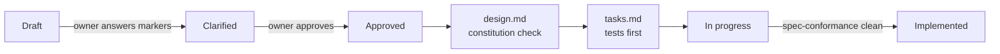

# Software Factory Kit

A bootstrap kit that takes a product from an empty repository to a release under one coherent
governance model: the conventions people and AI agents follow when specifying and writing code, the
protocol and prompts for auditing that code, and the documents both produce. It is **spec-driven**
— behaviour is specified, approved and traced to tests before and while it is built — and
**stack-aware**: one set of stack-neutral core conventions, realised per stack by profiles for
**Laravel**, **ASP.NET Core**, **Next.js** and **Vue**, mixed freely across the apps of a monorepo.

> **Status.** The payload in [`template/`](template/) is complete. The interactive scaffolder is
> planned, not built (see [Roadmap](#roadmap-the-interactive-scaffolder)); today a project is created
> by copying `template/` and running the bootstrap prompt with an AI agent.

## Quick start

### 1. Copy the payload into a new repository

Only `template/` is copied; this README, and everything else at the root, stays with the kit.

From a local checkout of the kit:

```bash
mkdir my-product && cd my-product && git init
cp -R ~/path/to/softfactory/template/. .
```

Without cloning the kit — one release tarball, no history — once the repository is published:

```bash
mkdir my-product && cd my-product && git init
tmp="$(mktemp -d)"
curl -fsSL https://github.com/<org>/<repo>/archive/refs/tags/<tag>.tar.gz \
  | tar -xz -C "$tmp" --strip-components=1
cp -R "$tmp/template/." .
rm -rf "$tmp"
```

`cp -R` copies the dotfile directories (`.ai/`, `.claude/`, `.github/`) and keeps the
`.claude/rules → ../.ai/rules` symlink a symlink, with both GNU and BSD `cp`.

### 2. Bootstrap with an agent

Open the new repository in Claude Code — or any agent that reads `AGENTS.md` — and say:

> *Run the bootstrap prompt.*

The agent follows [`.ai/prompts/bootstrap.md`](template/.ai/prompts/bootstrap.md). It asks you, in
one round:

- the product, and its capabilities in scope;
- the domain vocabulary;
- the external systems;
- the stack of each app;
- the shape of the system: apps, surfaces, modules and modularity level;
- your constraints.

It then:

- writes ADR-0001 (stacks) and ADR-0002 (shape) as Proposed;
- writes the context page and the glossary seed;
- fills `AGENTS.md` and the project's `README.md`;
- proposes removing the stack profiles no app uses;
- runs the G0 phase-gate audit.

### 3. Take the owner's decisions

Accept or amend the ADRs, approve the trimming, and when the gate report says G0 can close,
advance `AGENTS.md`'s **Phase** line. For a Laravel app using Laravel Boost, run
`php artisan boost:install`: Boost appends its block to `CLAUDE.md` and `AGENTS.md`, keeps
`.ai/rules/index.md` in the format already there, and owns `.ai/rules/boost/`. Never hand-write a
rule there; it is deleted on every sync.

## Using it day to day

Everything is driven by asking the agent in plain language; the prompts, conventions and rule
files tell it what to read, what to write and when to stop.

| You say | The agent | You get |
| --- | --- | --- |
| *Draft a spec for refunds* | Writes EARS requirements with permanent IDs, scenarios including refusals, quantified non-functional requirements, out of scope; marks every open question `[NEEDS CLARIFICATION: …]` | `docs/specs/NNNN-refunds/spec.md`, status Draft |
| *(you answer the markers)* | Records each answer in the clarification log | Status Clarified |
| *(you approve)* | — this step is yours alone | Status Approved |
| *Design spec 0007* | Places the work in modules and surfaces, runs the constitution check against every convention it touches, proposes ADRs for new decisions | `design.md`, and ADRs as Proposed |
| *Plan the tasks for 0007* | Orders small, verifiable tasks, acceptance tests before code, each citing its requirement IDs | `tasks.md` |
| *Implement 0007 T3* | Reads the rules and profile for the paths, writes the failing tagged test, then the code; ticks the task | Code, tests tagged `0007.R2`, a ticked box |
| *Verify spec 0007* | Runs the spec-conformance audit scoped to the spec, both directions: missing and divergent behaviour, and overreach | A clean run moves the spec to Implemented |
| *Fix: refunds over the balance are accepted* | Finds the requirement the bug contradicts — or reports a gap to specify first — and fixes it with a regression test tagged to it | A change for the `bugfix` PR template |
| *Plan a refactor of the billing module* | Scopes work that changes no behaviour | `docs/plans/<topic>.md` |
| *Run the naming audit* | Follows its prompt under the audit protocol, read-only | A report in `docs/reports/`, or rows in a living audit in `docs/audit/` |
| *Run the phase gate for G2* | Verifies every criterion of the gate and re-checks earlier ones for regression | A gate report and updated rows in `docs/audit/readiness.md` |
| *Record a rule: …* | Appends it to the matching `.ai/rules/` file (Boost's `record-rule` where installed) | A rule the next agent and the team will load |

Pull requests use `?template=feature.md`, `bugfix.md` or `hotfix.md` (or the default); each names
its spec, tasks and requirement IDs and links the conventions its checklist enforces.

**Reserved for the owner, never for an agent:** accepting ADRs, approving specs and their
amendments, answering clarification markers, waiving a gate criterion, advancing the **Phase** line,
and approving new dependencies, modules or top-level directories.

## Choosing your configuration

Each design choice decides which payload files a project keeps and which ADR records it. This
table is what bootstrap trims by hand today, and it is the contract the scaffolder will implement.

| Decision | Choices | Keeps | Removes | Recorded in |
| --- | --- | --- | --- | --- |
| Shape | Single app · monorepo | Single: the kit at the root. Monorepo: the kit at the root, rule globs re-rooted under each app's directory, each app's own documents in `apps/<app>/docs/` | — | ADR-0002 |
| Server stack, per app | Laravel · .NET · Next.js full-stack | `docs/conventions/stack-<name>.md` and `.ai/rules/<name>.md` for each stack in use | Profiles and rule files no app uses; `.ai/rules/index.md` regenerated | ADR-0001, `AGENTS.md` → **Stacks** |
| Frontend, per app | Vue · Next.js · none | `stack-vue.md` and `vue.md`, or `stack-nextjs.md` and `nextjs.md` | As above | ADR-0001 |
| Next.js mode | Full-stack · frontend over another app's API | Both live in `stack-nextjs.md` | — | ADR-0001 |
| Modularity | Not modular · Level 1 code · Level 2 data · Level 3 service | Everything; the modularity audit runs from G1 | Nothing. Not modular: the owner waives G1.2 and G3.6, citing ADR-0002 | ADR-0002 |
| Acceptance scenarios | In `spec.md` · a Gherkin runner (Behat, Reqnroll, playwright-bdd) | Runner: `docs/templates/feature.feature`, and `features/` as specs are written | No runner: `docs/templates/feature.feature` | ADR-0001 |
| Laravel Boost | Yes · no (Laravel apps only) | Yes: `php artisan boost:install` after the copy | — | ADR-0001 |
| Code host | GitHub · other | GitHub: `.github/PULL_REQUEST_TEMPLATE/` | Other: `.github/`, its checklists ported to the host's templates (GitLab: `.gitlab/merge_request_templates/`) | — |
| Database, cache, queue, hosting | Per app | No file changes; each profile covers its data-access options | — | ADR-0001 |

Always kept: the nine core conventions, every template the choices above do not remove, all
eighteen audit prompts (a *Stack notes* row for an absent stack is inert), the core rule files,
`docs/audit/readiness.md`, and `AGENTS.md`/`CLAUDE.md`. A core convention is never removed.

## How it works

### Core conventions and stack profiles

The core conventions speak one vocabulary — entry point, Command, Action, Query, Model, Response,
surface, module — and state each rule once. A profile maps that vocabulary onto a stack: a Laravel
FormRequest and Spatie Data object, a .NET `sealed record` handled by an `internal` handler, a
Next.js Zod schema behind a surface-wrapped server action. It also adds the stack's own traps. A
profile may sharpen a core rule or follow a language idiom where it says so; it never relaxes one.
Rule files route by file extension (`**/*.php`, `**/*.cs`, `**/*.tsx`, `**/*.vue`), so Laravel's
`app/` and the Next.js App Router's `app/` never collide.

### Four rule sets

| Rule set | Lives in | Read by |
| --- | --- | --- |
| **Spec rules** — what is built, and how it is proved | [`specs.md`](template/docs/conventions/specs.md); the `spec`, `design`, `tasks` and `feature` templates | The owner and agents before any behaviour change |
| **Code rules** — how code is shaped and written | [`architecture`](template/docs/conventions/architecture.md), [`coding`](template/docs/conventions/coding.md), [`frontend`](template/docs/conventions/frontend.md), [`security`](template/docs/conventions/security.md), [`testing`](template/docs/conventions/testing.md), the `stack-*` profiles, routed to by `.ai/rules/` | Agents before any edit; reviewers on every PR |
| **Audit rules** — how code is examined | [`auditing.md`](template/docs/conventions/auditing.md) (protocol, ownership, severity, evidence, verification) and [`.ai/prompts/audits/`](template/.ai/prompts/audits/) | Whoever runs an audit, person or agent |
| **Document rules** — where findings and decisions go | [`documentation.md`](template/docs/conventions/documentation.md), [`docs/templates/`](template/docs/templates/) | Everyone writing a document |

When two sources disagree, the payload's `AGENTS.md` ranks them, highest first:

1. the user's instruction;
2. the conventions;
3. path-scoped rules;
4. accepted ADRs and Approved specs;
5. generated framework guidelines;
6. existing code.

### Spec-driven development



- **Traceability:** it runs requirement → task → tagged test → code in every stack: Pest
  `->group('0007.R2')`, xUnit `[Trait("Requirement", "0007.R2")]`, a Vitest `[0007.R2]` title
  prefix, a Playwright `@0007.R2` tag, a Gherkin `@0007.R2` tag. "Is R2 proved?" is one grep.
  Requirement IDs never appear in code comments.
- **Overreach is a defect:** behaviour no requirement asks for is found by the spec-conformance
  audit's reverse sweep over every entry point, job, setting and form option.
- **Bugs and gaps:** a bug contradicts a requirement; behaviour no requirement covers is a gap, and
  gets specified before it is fixed.

### Lifecycle and gates

Five phases, each closed by a gate of checkable criteria — 40 in all, tracked in
[`docs/audit/readiness.md`](template/docs/audit/readiness.md) and verified by the phase-gate audit.

| Gate | Closes when |
| --- | --- |
| **G0 Bootstrap** | Stacks and shape decided in ADRs; context page and glossary; hygiene; one-command local boot; CI on every PR; PR templates |
| **G1 Foundation** | Surfaces declared; modules exist and their graph is enforced; arch tests; authentication and authorization specified and deny-by-default; logging, queues, fail-fast config; isolated test database; frontend shell; staging deploy; foundation audits clean |
| **G2 Build** | Every in-scope capability's spec Implemented; every requirement traced to a passing test; no High overreach; build audits run, no Critical |
| **G3 Harden** | Security, bugs, performance, simplification, dead code, complexity, naming, consistency, modularity, documentation drift, frontend and operations within their bars; a backup restored once |
| **G4 Release** | Phase gate at the release commit; zero open Critical or High; released specs listed; rollback tested; production configuration verified; tagged |

### Audits

Eighteen audits, every one read-only, sharing one protocol:

1. pin the commit;
2. declare the scope, the method and the bar;
3. give every finding a location, evidence, impact and fix;
4. re-verify every Critical and High;
5. state what was not checked.

Each concern has exactly one owning audit, so a finding is filed once and linked elsewhere.

| When | Audits |
| --- | --- |
| Closing G1 | architecture-conformance, modularity (when modular), dependencies, operations |
| Each spec reaching Implemented | spec-conformance, scoped to that spec |
| Closing G2 | spec-conformance, consistency, bugs, database-schema, frontend, test-coverage; architecture-conformance and modularity re-run |
| Closing G3 | security, bugs, performance, simplification, dead-code, complexity, naming, consistency, modularity, documentation-drift, frontend, operations |
| Every gate and every release | phase-gate |
| After an incident, upgrade, port or cross-module refactor | the targeted ones in `auditing.md` → *Cadence* |

## What's in this repository

```
README.md                         This manual — stays with the kit
AGENTS.md, CLAUDE.md              Instructions for agents maintaining the kit — stay with the kit
template/                         The payload — copied into every new project
  AGENTS.md                       The project's entry point: authority, stacks, spec-driven
                                  development, read-before-write, phase (filled at bootstrap)
  CLAUDE.md                       Imports AGENTS.md for Claude Code
  README.md                       The project's own README, filled at bootstrap
  .claude/rules -> ../.ai/rules   Claude Code loads each rule file when a matching path is touched
  .ai/
    rules/                        Path-scoped agent rules, in Laravel Boost's format
      index.md                    Glob → rule file, exactly as Boost regenerates it
      general backend frontend database tests specs docs audits    — core
      laravel dotnet nextjs vue                                    — per stack
    prompts/
      bootstrap.md                Runbook for Phase 0
      audits/                     One runnable prompt per audit type (18)
  docs/
    conventions/                  Normative rules
      architecture coding frontend security testing                — how code is written, any stack
      specs                                                        — how behaviour is specified
      stack-laravel stack-dotnet stack-nextjs stack-vue            — how each stack realises the core
      documentation auditing lifecycle                             — how the project is run
    templates/                    One template per document type (13)
    audit/readiness.md            Living tracker of every gate criterion, starting at 0 of 40
  .github/PULL_REQUEST_TEMPLATE/  default, feature, bugfix, hotfix
```

## Extending the kit

All changes to what projects receive happen in `template/`; the root `AGENTS.md` lists the
invariants a change must keep.

- **A code rule:** add it under the matching heading of the core convention, with its reason and
  its realisation in each profile that needs one; propose an arch test when it is mechanically
  checkable.
- **A stack:** write `template/docs/conventions/stack-<name>.md` from the `convention.md` template,
  mapping every row of the core concepts table. Then:
  - add `template/.ai/rules/<name>.md` with its globs;
  - add the profile's row to the payload `AGENTS.md`;
  - add a *Stack notes* row to every audit prompt;
  - add it to [Choosing your configuration](#choosing-your-configuration);
  - regenerate `index.md`.
- **An audit:** start from the `audit-prompt.md` template. Add it to the catalog and the ownership
  table in `auditing.md`, and, if a gate requires it, to `lifecycle.md` and `readiness.md`.
- **A trap found while using the kit in a project:** record it in that project's `.ai/rules/`; if it
  holds for every project, bring it back here.

## Roadmap: the interactive scaffolder

Not built yet. The decisions so far:

- **Language:** Bash compatible with 3.2, macOS's system bash.
- **Scope:** kit only — it copies and fills the payload, and installs no framework and generates no
  application code.
- **Delivery:** one `install.sh` that fetches over HTTPS without cloning.

Still open:

- where it is hosted, and the install URL;
- the release and tag scheme;
- the manifest format.

### Intended use

```bash
# interactive
curl -fsSL https://<host>/install.sh | bash -s -- my-product

# reproducible, no prompts — CI, or a second project with the same architecture
curl -fsSL https://<host>/install.sh | bash -s -- my-product --answers architecture.answers

# read before you run — recommended for anything piped to a shell
curl -fsSLo install.sh https://<host>/install.sh && less install.sh && bash install.sh my-product
```

### What it will do

1. **Ask** the questions in [Choosing your configuration](#choosing-your-configuration): shape;
   per app its path, server stack, frontend stack and Next.js mode; modularity level and modules;
   acceptance-scenario runner; Laravel Boost; code host. Answers come from prompts, from flags, or
   from an answers file that is parsed, never sourced.
2. **Fetch** the tarball of its own pinned release and verify it against the release's published
   SHA-256 checksum.
3. **Select** only the template paths a root-level `manifest` assigns to the answers. That
   manifest becomes the single source of truth, and the configuration table above its readable twin.
4. **Fill** what the answers already decide:
   - the **Stacks** table and the project README's app table;
   - ADR-0001 and ADR-0002 drafted as Proposed, their alternatives left to bootstrap;
   - rule globs re-rooted for a monorepo;
   - `.ai/rules/index.md` regenerated in Boost's exact format.
5. **Record** the kit version and the answers in the project, so a later run can show what an
   upgrade would change.
6. **Hand over** to the agent's bootstrap prompt. Bootstrap then asks only what a script cannot:
   the product, its capabilities, the vocabulary and the constraints.

### Guarantees it will keep

- Safe to pipe:
  - the body is one function, called on the script's last line, so a truncated download executes
    nothing;
  - prompts read from `/dev/tty`, because stdin is the script.
- Bash 3.2 throughout: no associative arrays, `${var,,}`, `mapfile` or `|&`. Its only dependencies
  are `curl`, `tar` and POSIX utilities.
- Refuses a non-empty directory unless `--dry-run` has listed what would change and `--force` is
  given.
- Writes nothing outside the target directory, and never uses `sudo`.
- Makes no commit, and makes no network call beyond the release download.

## Origin

Derived from the rulesets of the zuus monorepo (`30443ad8b`, 2026-11-22): its `AGENTS.md`,
conventions, templates, app-level conventions, pull-request templates and database-schema audit
prompt. They were generalised, split into a stack-neutral core with four profiles, and extended:

- spec-driven development;
- security, testing, documentation, auditing and lifecycle conventions;
- module boundaries as governed seams with declared modularity levels;
- rules distilled from zuus's own audit reports;
- seventeen further audit prompts.

The pull-request checklists now link the conventions instead of restating them; zuus's restated
checklist had drifted from its own architecture convention.
