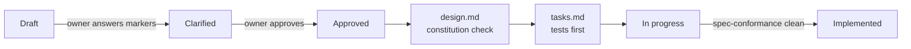

# SpecForge

A ruleset for building software with AI coding agents, and the means to add it to a project — one
with no code yet, or one long in production. It brings:

- **Coding rules:** stack-neutral core conventions, realised per stack by profiles for **Laravel**,
  **ASP.NET Core**, **Next.js** and **Vue**.
- **Spec rules:** spec-driven development, where behaviour is specified, approved and traced to
  tests.
- **Audit rules:** eighteen read-only audits under one protocol.
- **Document rules:** where every decision, finding and plan is written.

The rules reach **every coding agent** — Claude Code, Codex, Cursor, Copilot, Windsurf,
Antigravity, Gemini CLI and Kiro — from one source, and are enforced by a check that runs in CI
whoever wrote the change.

It is not a project scaffolder or a repository template. It creates no project, no application
code and no project infrastructure, and it needs no version control.

> **Status.** The ruleset in [`template/`](template/) is complete, and installs by hand today. The
> installer is planned, not built (see [Roadmap](#roadmap-the-installer)).

## Install

### 1. Add the rules to your project

Only `template/` is installed. This README and everything else at the root stay with the kit. The
same commands serve a new project and an existing one, because nothing that is already there is
overwritten:

```bash
KIT=~/path/to/specforge/template        # a local checkout of the kit
PROJECT=~/code/my-app                   # the project, new or existing

cd "$KIT" && find . -type f | while IFS= read -r f; do
  if [ -e "$PROJECT/$f" ]; then
    printf 'kept yours: %s\n' "$f"
  else
    mkdir -p "$PROJECT/$(dirname "$f")" && cp -p "$f" "$PROJECT/$f"
  fi
done
```

Without a checkout — one release tarball, no history — once the kit is published:

```bash
tmp="$(mktemp -d)"
curl -fsSL https://github.com/<org>/<repo>/archive/refs/tags/<tag>.tar.gz \
  | tar -xz -C "$tmp" --strip-components=1
KIT="$tmp/template"      # then run the loop above, and: rm -rf "$tmp"
```

Every `kept yours:` line is a file your project already had. The agent reconciles each one during
adoption; nothing is merged silently.

### 2. Choose your agents

Uncomment the agents that work in the project in `.ai/agents`, then generate their rule files:

```bash
.ai/bin/sync-rules
```

### 3. Hand over to an agent

Open the project in any of those agents and say one of these:

| The project… | Say | The agent follows |
| --- | --- | --- |
| has no code yet | *Run the bootstrap prompt.* | [`bootstrap.md`](template/.ai/prompts/bootstrap.md) |
| already has code | *Run the adopt prompt.* | [`adopt.md`](template/.ai/prompts/adopt.md) |

**Bootstrap** asks you, in one round, for:
- the product, its capabilities and its vocabulary;
- the stack of each app;
- the shape of the system: apps, surfaces, modules and modularity level;
- which agents you use, and your constraints.

It then writes ADR-0001 and ADR-0002 as Proposed, the context page and the glossary seed, and fills
`AGENTS.md`. It *reports* — never creates — the project infrastructure G0 expects.

**Adopt** reads the code first and asks only what the code cannot settle. It then:
- records the existing stacks and shape as retroactive ADRs;
- lists every existing capability on a **legacy register**;
- runs baseline audits;
- measures existing violations for **baselines that only shrink**;
- assesses every gate to name the phase the evidence supports.

Both end with a phase-gate report.

### 4. Take the owner's decisions, and switch on enforcement

- Accept or amend the ADRs, and set `AGENTS.md`'s **Phase** line from the gate report.
- Add `.ai/bin/check` to CI beside each app's lint, type check, tests and arch tests.
- For a Laravel app with Laravel Boost, run `php artisan boost:install`. Boost keeps
  `.ai/rules/index.md` in the format `sync-rules` writes, and owns `.ai/rules/boost/`.

## How the rules reach every agent

Agents disagree on where path-scoped rules live and how a rule declares its files, and some silently
drop a rule they cannot parse. So the rules are written once and delivered three ways:

1. **`AGENTS.md`, read by every agent.** It carries the authority order and the read-before-write
   protocol, including *"open `.ai/rules/index.md` and read every rule whose globs cover the paths
   you touch"*. An agent with no rules mechanism of its own still follows the rules this way.
2. **Native copies, generated.** `.ai/rules/*.md` is the one source. For each agent in `.ai/agents`,
   `.ai/bin/sync-rules` writes that agent's own format, so the agent loads the right rule
   automatically when it touches a matching file:

   | Agent | Generated | Scoped by |
   | --- | --- | --- |
   | Claude Code | `.claude/rules/ai-*.md` (`CLAUDE.md` imports `AGENTS.md`) | `paths:` |
   | Cursor | `.cursor/rules/ai-*.mdc` | `globs:` / `alwaysApply:` |
   | GitHub Copilot | `.github/instructions/ai-*.instructions.md` | `applyTo:` |
   | Windsurf / Devin | `.windsurf/rules/ai-*.md` | `trigger: glob` / `globs:` |
   | Google Antigravity | `.agents/rules/ai-*.md` | `trigger: glob` / `globs:` |
   | Kiro | `.kiro/steering/ai-*.md` | `inclusion: fileMatch` / `fileMatchPattern:` |
   | Gemini CLI | `.gemini/settings.json`, if absent, pointing it at `AGENTS.md` | — |
   | Codex | nothing: it reads `AGENTS.md` | — |

   Each generated file carries a marker line. Files without that marker — your team's own rules
   beside them — are never overwritten or removed. Removing an agent from `.ai/agents` removes its
   generated files. `sync-rules` also writes `.ai/rules/index.md` byte for byte as Laravel Boost
   does, and reports any rule whose frontmatter Boost would rewrite.
3. **Enforcement that ignores who wrote the change.** Instructions guide an agent; they do not stop
   one. `.ai/bin/check` runs in CI and fails when:
   - a generated file has drifted from `.ai/rules/`;
   - a placeholder is left after Phase 0;
   - a requirement of an Implemented spec is cited by no test;
   - `AGENTS.md` outgrows Codex's 32 KiB, or an Antigravity rule its 24,000 bytes.

   The stack's own gates — lint, type check, tests, arch tests — run beside it.

Both scripts are Bash 3.2 with POSIX tools: no git, no network, no runtime of any stack.

## Using it day to day

Everything is driven by asking the agent in plain language. The prompts, conventions and rule files
tell it what to read, what to write and when to stop.

| You say | The agent | You get |
| --- | --- | --- |
| *Draft a spec for refunds* | Writes EARS requirements with permanent IDs; scenarios, refusals included; quantified non-functional requirements; what is out of scope. Marks every open question `[NEEDS CLARIFICATION: …]` | `docs/specs/NNNN-refunds/spec.md`, status Draft |
| *(you answer the markers)* | Records each answer in the clarification log | Status Clarified |
| *(you approve)* | — this step is yours alone | Status Approved |
| *Design spec 0007* | Places the work in modules and surfaces, checks the design against every convention it touches, proposes ADRs for new decisions | `design.md`, and ADRs as Proposed |
| *Plan the tasks for 0007* | Orders small, verifiable tasks — acceptance tests before code — each citing its requirement IDs | `tasks.md` |
| *Implement 0007 T3* | Reads the rules and profile for the paths, writes the failing tagged test, then the code; ticks the task | Code, tests tagged `0007.R2`, a ticked box |
| *Verify spec 0007* | Runs the spec-conformance audit scoped to the spec, in both directions: missing and divergent behaviour, and overreach | A clean run moves the spec to Implemented |
| *Change how invoices round totals* (a legacy capability) | Pins today's behaviour with characterization tests, writes the spec that states it, then amends that spec for the change | A spec, and the legacy-register row closed when it is Implemented |
| *Fix: refunds over the balance are accepted* | Finds the requirement the bug contradicts — or reports a gap to specify first — and fixes it with a regression test tagged to it | A change for the `bugfix` PR template |
| *Plan a refactor of the billing module* | Scopes work that changes no behaviour | `docs/plans/<topic>.md` |
| *Run the naming audit* | Follows its prompt under the audit protocol, read-only | A report in `docs/reports/`, or rows in a living audit |
| *Run the phase gate for G2* | Verifies every criterion of the gate, and re-checks earlier ones for regression | A gate report and updated rows in `docs/audit/readiness.md` |
| *Record a rule: …* | Appends it to the matching `.ai/rules/` file, then runs `.ai/bin/sync-rules` | A rule every agent and the team will load |

**Reserved for the owner, never for an agent:**
- accepting ADRs, retroactive ones included;
- approving specs and their amendments;
- answering clarification markers;
- waiving a gate criterion;
- setting the **Phase** line;
- approving a baseline, a new dependency, module or top-level directory.

## Choosing your configuration

Each choice decides which rule files a project keeps and which ADR records it. Bootstrap and adopt
apply this table by hand today; it is the contract the installer will implement.

| Decision | Choices | Keeps | Removes | Recorded in |
| --- | --- | --- | --- | --- |
| Project state | No code yet · existing code | No code: `bootstrap.md` path. Existing: `adopt.md` path, `docs/audit/legacy-capabilities.md`, baselines | — | ADR-0001/0002 (retroactive when existing) |
| Agents | Any of the eight above | Their lines in `.ai/agents`, and the files `sync-rules` generates | Generated files of agents not listed | `.ai/agents` |
| Shape | Single app · monorepo | Single: the rules at the project root. Monorepo: the rules at the root, rule globs re-rooted under each app's directory, each app's own documents in `apps/<app>/docs/` | — | ADR-0002 |
| Server stack, per app | Laravel · .NET · Next.js full-stack | `docs/conventions/stack-<name>.md` and `.ai/rules/<name>.md` for each stack in use | Profiles and rule files no app uses; then `sync-rules` | ADR-0001, `AGENTS.md` → **Stacks** |
| Frontend, per app | Vue · Next.js · none | `stack-vue.md` and `vue.md`, or `stack-nextjs.md` and `nextjs.md` | As above | ADR-0001 |
| Next.js mode | Full-stack · frontend over another app's API | Both live in `stack-nextjs.md` | — | ADR-0001 |
| Modularity | Not modular · Level 1 code · Level 2 data · Level 3 service | Everything; the modularity audit runs from G1 | Nothing. Not modular: the owner waives G1.2 and G3.6, citing ADR-0002 | ADR-0002 |
| Acceptance scenarios | In `spec.md` · a Gherkin runner (Behat, Reqnroll, playwright-bdd) | Runner: `docs/templates/feature.feature`, and `features/` as specs are written | No runner: `docs/templates/feature.feature` | ADR-0001 |
| Laravel Boost | Yes · no (Laravel apps only) | Yes: `php artisan boost:install` after installing the rules | — | ADR-0001 |
| Code host | GitHub · other | GitHub: `.github/PULL_REQUEST_TEMPLATE/` | Other: those templates, their checklists ported to the host's | — |
| Database, cache, queue, hosting | Per app | No file changes; each profile covers its data-access options | — | ADR-0001 |

Always kept:
- the nine core conventions;
- every template the choices above do not remove;
- all eighteen audit prompts (a *Stack notes* row for an absent stack is inert);
- the core rule files and `.ai/bin/`;
- `docs/audit/readiness.md`, `AGENTS.md` and `CLAUDE.md`.

## How it works

### Core conventions and stack profiles

The core conventions use one vocabulary — entry point, Command, Action, Query, Model, Response,
surface, module — and state each rule once. A profile maps that vocabulary onto a stack:
- Laravel: a FormRequest and a Spatie Data object;
- .NET: a `sealed record` handled by an `internal` handler;
- Next.js: a Zod schema behind a surface-wrapped server action.

A profile adds its stack's own pitfalls, and may sharpen a core rule or follow a language idiom
where it says so. It never relaxes a core rule. Rule files route by file extension (`**/*.php`,
`**/*.cs`, `**/*.tsx`, `**/*.vue`), so Laravel's `app/` and the Next.js App Router's `app/` never
collide.

### Four rule sets

| Rule set | Lives in | Read by |
| --- | --- | --- |
| **Spec rules** — what is built, and how it is proved | [`specs.md`](template/docs/conventions/specs.md); the `spec`, `design`, `tasks` and `feature` templates | The owner and agents before any behaviour change |
| **Code rules** — how code is shaped and written | [`architecture`](template/docs/conventions/architecture.md), [`coding`](template/docs/conventions/coding.md), [`frontend`](template/docs/conventions/frontend.md), [`security`](template/docs/conventions/security.md), [`testing`](template/docs/conventions/testing.md), the `stack-*` profiles, routed to by `.ai/rules/` | Agents before any edit; reviewers on every PR |
| **Audit rules** — how code is examined | [`auditing.md`](template/docs/conventions/auditing.md) — protocol, ownership, severity, evidence, verification — and [`.ai/prompts/audits/`](template/.ai/prompts/audits/) | Whoever runs an audit, person or agent |
| **Document rules** — where findings and decisions go | [`documentation.md`](template/docs/conventions/documentation.md), [`docs/templates/`](template/docs/templates/) | Everyone writing a document |

When sources disagree, `AGENTS.md` ranks them, highest first:
1. the user's instruction;
2. the conventions;
3. the path-scoped rules;
4. accepted ADRs and Approved specs;
5. generated framework guidelines;
6. existing code.

### Spec-driven development



- **Traceability:** each requirement is followed through task, tagged test and code in every stack,
  so "is R2 proved?" is one grep, and `.ai/bin/check` asks it on every change. The tags:
  - Pest: `->group('0007.R2')`
  - xUnit: `[Trait("Requirement", "0007.R2")]`
  - Vitest: a `[0007.R2]` title prefix
  - Playwright and Gherkin: a `@0007.R2` tag
- **Overreach:** behaviour no requirement asks for is a defect. The spec-conformance audit's reverse
  sweep finds it.
- **Existing projects:** behaviour that predates the rules sits on the legacy register instead, and
  gets its spec the first time it changes.

### Lifecycle and gates

Five phases, each closed by a gate of checkable criteria — 40 in all. They are tracked in
[`docs/audit/readiness.md`](template/docs/audit/readiness.md) and verified by the phase-gate audit.
A new project starts at G0. An adopted one is assessed against every gate, and the owner sets its
phase from the evidence.

| Gate | Closes when |
| --- | --- |
| **G0 Bootstrap** | Rules installed and agents configured; stacks and shape decided in ADRs; context page and glossary; hygiene; one-command local boot; CI with `.ai/bin/check`; PR templates |
| **G1 Foundation** | Surfaces declared; modules exist and their graph is enforced; arch tests; authentication and authorization specified and deny-by-default; logging, queues, fail-fast config; isolated test database; frontend shell; staging deploy; foundation audits clean |
| **G2 Build** | Every in-scope capability's spec Implemented, legacy ones included; every requirement traced to a passing test; no High overreach; build audits run, no Critical |
| **G3 Harden** | Security, bugs, performance, simplification, dead code, complexity, naming, consistency, modularity, documentation drift, frontend and operations within their bars; a backup restored once |
| **G4 Release** | Phase gate at the release commit; zero open Critical or High; released specs listed; rollback tested; production configuration verified; tagged |

### Audits

Eighteen audits, all read-only, under one protocol:
1. pin the commit;
2. declare the scope, the method and the bar;
3. give every finding a location, evidence, impact and fix;
4. re-verify every Critical and High;
5. state what was not checked.

Each concern has exactly one owning audit, so a finding is filed once and linked elsewhere.

| When | Audits |
| --- | --- |
| Adopting an existing project | architecture-conformance, modularity (when modular), security, test-coverage, dependencies, spec-conformance in register mode |
| Closing G1 | architecture-conformance, modularity (when modular), dependencies, operations |
| Each spec reaching Implemented | spec-conformance, scoped to that spec |
| Closing G2 | spec-conformance, consistency, bugs, database-schema, frontend, test-coverage; architecture-conformance and modularity re-run |
| Closing G3 | security, bugs, performance, simplification, dead-code, complexity, naming, consistency, modularity, documentation-drift, frontend, operations |
| Every gate and every release | phase-gate |
| After an incident, upgrade, port or cross-module refactor | the targeted ones in `auditing.md` → *Cadence* |

## What's in this repository

```
README.md                         This manual — stays with the kit
AGENTS.md, CLAUDE.md              Instructions for agents maintaining the kit — stay with the kit
template/                         The ruleset — installed into a project
  AGENTS.md                       The project's entry point for every agent: authority, stacks,
                                  rules for every agent, spec-driven development, read-before-write
  CLAUDE.md                       Imports AGENTS.md for Claude Code
  .ai/
    agents                        The coding agents in use — the project uncomments its own
    bin/sync-rules                Generates each agent's native rule files and the rules index
    bin/check                     The agent-independent gate for CI
    rules/                        The one source of path-scoped rules, in Laravel Boost's format
      general backend frontend database tests specs docs audits    — core
      laravel dotnet nextjs vue                                    — per stack
    prompts/
      bootstrap.md                Phase 0 for a project with no code yet
      adopt.md                    Adoption of a project that already has code
      audits/                     One runnable prompt per audit type (18)
  docs/
    conventions/                  Normative rules
      architecture coding frontend security testing                — how code is written, any stack
      specs                                                        — how behaviour is specified
      stack-laravel stack-dotnet stack-nextjs stack-vue            — how each stack realises the core
      documentation auditing lifecycle                             — how the project is run
    templates/                    One template per document type (13)
    audit/readiness.md            Living tracker of every gate criterion, starting at 0 of 40
  .github/PULL_REQUEST_TEMPLATE/  default, feature, bugfix, hotfix
```

## Extending the kit

Every change to what projects receive happens in `template/`. The root `AGENTS.md` lists the
invariants a change must keep.

- **A code rule:** add it under the matching heading of the core convention, with its reason and
  its realisation in each profile that needs one. Propose an arch test when it is mechanically
  checkable.
- **A stack:**
  - write `template/docs/conventions/stack-<name>.md` from the `convention.md` template, mapping
    every row of the core concepts table;
  - add `template/.ai/rules/<name>.md` with its globs;
  - add the profile's row to the payload `AGENTS.md`;
  - add a *Stack notes* row to every audit prompt;
  - add the stack to [Choosing your configuration](#choosing-your-configuration).
- **An agent:**
  - check its current documentation for where rules live and how a rule declares its files;
  - add a case to `render` in `template/.ai/bin/sync-rules`, its directory to `AGENT_DIRS` and its
    key to `KNOWN`;
  - add its line to `template/.ai/agents`, and its row to the table above;
  - smoke-run on a scratch copy of `template/` with every agent enabled.
- **An audit:** start from the `audit-prompt.md` template. Add it to the catalog and the ownership
  table in `auditing.md`, and, if a gate requires it, to `lifecycle.md` and `readiness.md`.
- **A trap found while using the rules in a project:** record it in that project's `.ai/rules/`. If
  it holds for every project, bring it back here.

## Roadmap: the installer

Not built yet.

**Decided:**
- Bash, compatible with 3.2.
- Rules only: it never creates a project, application code or project infrastructure.
- One `install.sh`, fetched over HTTPS without cloning.
- One behaviour for a new or an existing project, with or without git.
- `install`, `update` and `remove`.
- The project's file always wins; the kit's version is written beside it as
  `<file>.specforge-incoming`.
- What was installed is recorded in `.ai/specforge.lock`.

**Open:**
- where it is hosted, and the install URL;
- the release and tag scheme;
- the format of the root `manifest`, which maps each choice to template paths, and of
  `.ai/specforge.lock`.

### Intended use

```bash
# into the current directory, interactively
curl -fsSL https://<host>/install.sh | bash -s -- install

# into another directory, no prompts — CI, or a second project with the same architecture
curl -fsSL https://<host>/install.sh | bash -s -- install --dir ~/code/my-app --answers rules.answers

# later: newer rules, your edits kept — or take back exactly what was installed
curl -fsSL https://<host>/install.sh | bash -s -- update
curl -fsSL https://<host>/install.sh | bash -s -- remove

# read before you run — recommended for anything piped to a shell
curl -fsSLo install.sh https://<host>/install.sh && less install.sh && bash install.sh install --dry-run
```

### What it will do

1. **Detect:**
   - stacks: `composer.json` with `artisan`; `*.sln`/`*.csproj`; `next.config.*`; `vue` in
     `package.json`;
   - the layout, and Laravel Boost;
   - the agents already configured, and instruction or docs files already present.

   A project with no code detects nothing.
2. **Ask** the questions in [Choosing your configuration](#choosing-your-configuration), each
   defaulting to what detection found. Answers come from prompts, flags, or an answers file, which
   is parsed, never sourced.
3. **Fetch** the tarball of its pinned release and verify its published SHA-256 checksum.
4. **Plan** every file it would write, keep or skip. `--dry-run` stops here.
5. **Install** under one policy for first installs and updates alike:

   | File | `install` / `update` | `remove` |
   | --- | --- | --- |
   | Not present | Write it | — |
   | Installed by the kit, unmodified since (checksum matches) | Update it | Delete it |
   | Modified since, or the project's own | Keep it; write the kit's beside it as `*.specforge-incoming`, and report it | Keep it |
   | Shared entry files (`AGENTS.md`, `CLAUDE.md`, `GEMINI.md`) | Write only between `<!-- specforge:begin -->` and `<!-- specforge:end -->` | Remove that block |
   | Your README, ignore files, settings JSON | Never touched; print what to add | — |

6. **Fill** what the answers already decide:
   - the **Stacks** table;
   - ADR-0001 and ADR-0002 drafts;
   - rule globs re-rooted for a monorepo.

   Then run `.ai/bin/sync-rules` for the chosen agents.
7. **Record** in `.ai/specforge.lock` the kit version, the answers, and a checksum of every
   installed file.
8. **Hand over:** to `bootstrap.md` when there is no code, to `adopt.md` when there is. Either then
   asks only what a script cannot.

### Guarantees it will keep

- **Safe to pipe:**
  - the body is one function, called on the last line, so a truncated download runs nothing;
  - prompts read from `/dev/tty`, because stdin is the script.
- **Portable:** Bash 3.2 throughout, needing only `curl`, `tar` and POSIX tools — not `git`.
- **Never overwrites** a file it did not install unmodified.
- **Version control is optional:** in a git work tree it reports uncommitted changes and records
  the commit, but never commits or creates a branch.
- **Contained:** it writes nothing outside the target directory, never uses `sudo`, and makes no
  network call beyond the release download.

## Origin

Derived from the rulesets of the zuus monorepo (`30443ad8b`, 2026-11-22): its `AGENTS.md`,
conventions, templates, app-level conventions, pull-request templates and database-schema audit
prompt. They were generalised, split into a stack-neutral core with four profiles, and extended
with:

- spec-driven development, with a legacy path for existing code;
- security, testing, documentation, auditing and lifecycle conventions;
- module boundaries as governed seams with declared modularity levels;
- rules distilled from zuus's own audit reports;
- seventeen further audit prompts;
- delivery to every major coding agent.

The pull-request checklists now link the conventions instead of restating them; zuus's restated
checklist had drifted from its own architecture convention.
