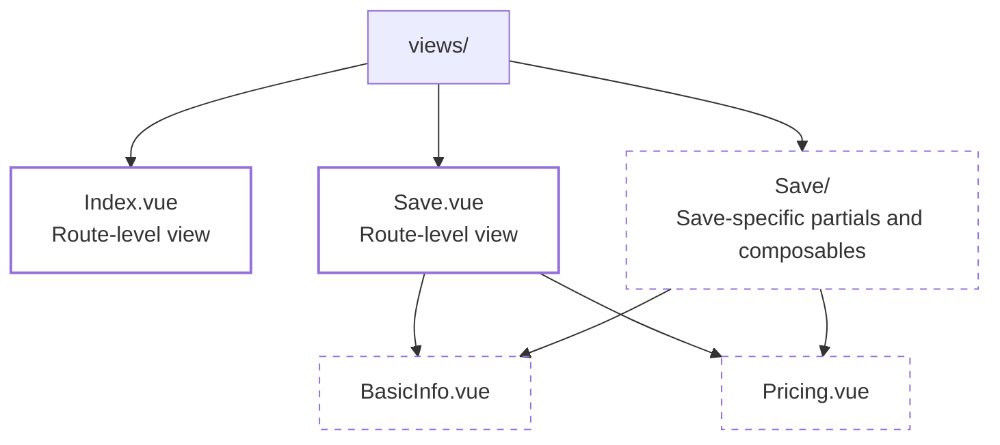

# Vue Profile

How [`frontend.md`](frontend.md) is realised in a Vue 3 SPA, and the rules only Vue needs.
Normative for every frontend the **Stacks** table in `AGENTS.md` assigns to Vue — typically the
panels of a Laravel or .NET app. The stack is Vue 3 with `<script setup lang="ts">` and the
Composition API, Pinia, Vue Router 4, TailwindCSS v4 and Vite; versions are fixed by the stack ADR.

## Scope

Applies to:

- every `*.vue` file, and the `*.ts` and `*.css` files of a Vue SPA
- workspace packages consumed by Vue SPAs

## The tree

```
<spa>/js/
├── app/                    wiring only: App.vue, router root, plugins (pinia, i18n)
├── shared/                 cross-feature and domain-agnostic
│   ├── ui/                 BaseButton.vue, BaseModal.vue: the design system
│   ├── composables/        useBreakpoint, useClipboard
│   ├── lib/                http client, formatters
│   └── types/
├── features/
│   └── <feature>/          kebab-case, one per domain, mirroring the server module
│       ├── views/          route-level views
│       │   ├── Index.vue
│       │   ├── Save.vue
│       │   └── Save/       files used only by Save.vue
│       │       ├── BasicInfo.vue
│       │       └── useBasicInfoForm.ts
│       ├── components/     used by more than one view of this feature
│       ├── composables/
│       ├── stores/
│       ├── api/            this feature's requests
│       ├── validation/
│       ├── routes.ts       merged by app/router
│       ├── types.ts
│       └── index.ts        what other features may import
└── main.ts
```



## Views and partials

- Route-level views always live under `views/`, even when the feature has only one view.
- Files exclusive to a view live in a directory named after that view, in the view's PascalCase:
  `views/Save.vue` owns `views/Save/`. A file used only by another partial belongs to the same view.
- Never `views/partials/`, and never a shared component inside a view directory.

## Naming

- Folders are kebab-case; a view's partial directory takes the view's PascalCase name.
- Single-file components and modules exporting a component or class are PascalCase
  (`BasicInfo.vue`, `CouponValidation.ts`); composables are camelCase with `use`
  (`useBasicInfoForm.ts`); other modules are camelCase (`formatDate.ts`); index modules are
  `index.ts`, lowercase.
- Base components begin with `Base`; single-instance layout components with `The` (`TheHeader.vue`);
  domain components are multi-word.
- Validation schemas mirror the feature path and end in `Validation`.
- Asset files are PascalCase; icons end in `Icon`, other images in `Image`.

## Routing

- Each feature exports its routes from `routes.ts`; `app/router` merges them and owns nothing else.
- Every route is named, and navigation uses the name: `<router-link :to="{ name: 'UsersIndex' }">`.

  | Path | Route name | View |
  | --- | --- | --- |
  | `/users` | `UsersIndex` | `Index.vue` |
  | `/users/create` | `UsersCreate` | `Save.vue` |
  | `/users/:id` | `UsersShow` | `Show.vue` |
  | `/users/:id/edit` | `UsersEdit` | `Save.vue` |

## State and data

- A Pinia store holds state shared across views or surviving navigation; one view's state stays in
  the view or its composable.
- Server types are imported from the generated declarations (Spatie TypeScript transformer, or the
  OpenAPI client for a .NET backend).

## Raw HTML

`v-html` is the raw-HTML sink: only on HTML sanitized server-side for that purpose.

## Tooling

- `lint` runs ESLint then Prettier and is the one command; `lint:fix` writes. Every workspace package
  carries the same scripts and re-exports the shared config.
- Prettier runs `prettier-plugin-tailwindcss`. Each project with a Tailwind entrypoint names it in
  `tailwindStylesheet` in its own `prettier.config.js`, because the plugin resolves the path against
  the config's directory.
- `vue-tsc --noEmit` is a CI gate.
- Tests: Vitest with Vue Test Utils for components, titled with the requirement ID
  (`it('[0012.R3] …')`); Playwright for journeys.

---

Related: [`frontend.md`](frontend.md) · [`stack-laravel.md`](stack-laravel.md)
